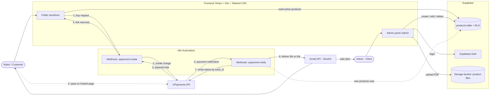
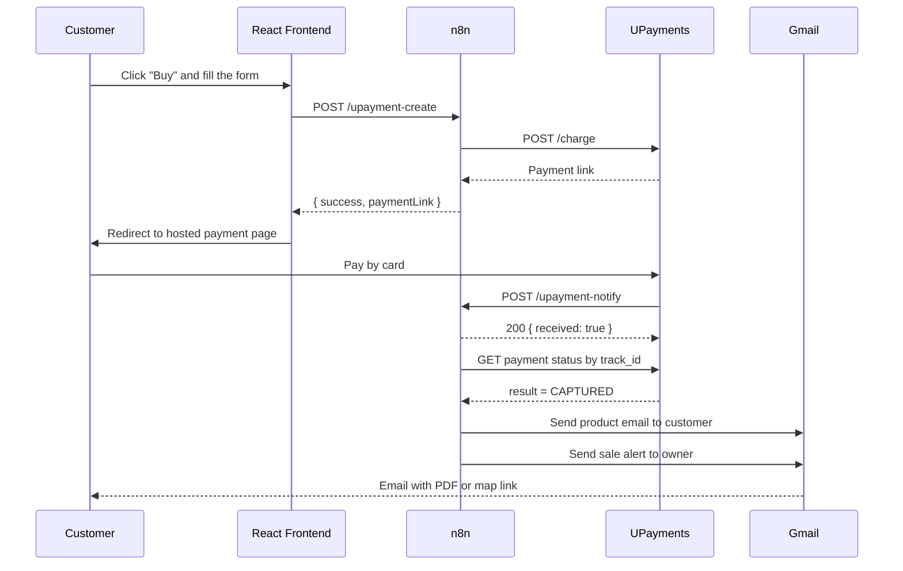
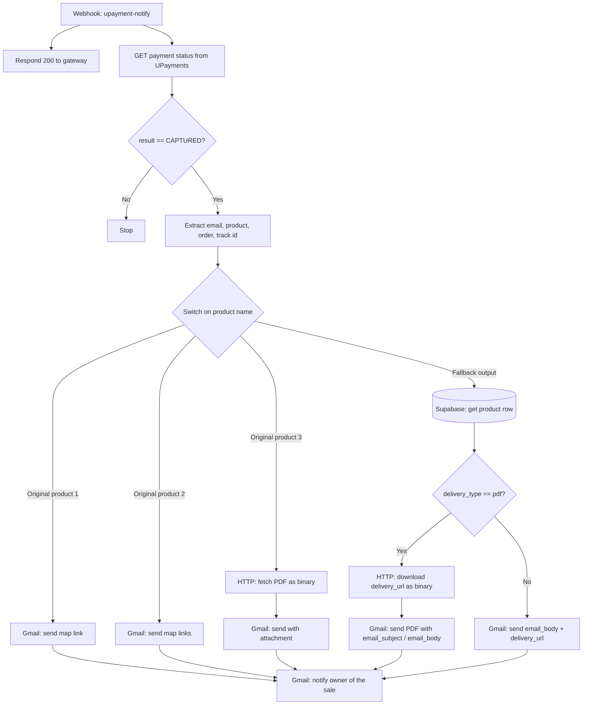

# Digital Travel Platform — Moayad Alzoabi

> **Case Study** · From a static 3-product site to a database-driven store with automated payment and delivery.
> 🔗 **Live:** [alzoabi.travel](https://alzoabi.travel/)

<div dir="rtl" align="right">

## نبذة بالعربي

هذا المشروع بنيته وأطلقته لصانع محتوى سفر (مؤيد الزعبي). كان الموقع ثابتاً بثلاث منتجات مكتوبة يدوياً داخل الكود وداخل أتمتة الدفع، فأي منتج جديد أو تعديل سعر كان يحتاج تدخلاً برمجياً.

حوّلته إلى نظام ديناميكي: المنتجات تُسحب من قاعدة بيانات، ولوحة تحكم عربية محمية يضيف منها العميل الخدمات ويرفع ملفات الـ PDF بنفسه من هاتفه، وأتمتة على n8n تستقبل الدفع وتسلّم الملف للزبون على الإيميل تلقائياً دون أي تدخل.

هذا المستودع **Case Study** يشرح المعمارية وطريقة التفكير، وكود العميل نفسه غير منشور حفاظاً على خصوصيته.

</div>

---

## Table of Contents

1. [Overview](#overview)
2. [Problem & Solution](#problem--solution)
3. [System Architecture](#system-architecture)
4. [Tech Stack](#tech-stack)
5. [Key Features](#key-features)
6. [How the Hybrid n8n Flow Works](#how-the-hybrid-n8n-flow-works)
7. [Data Contract Between Supabase and n8n](#data-contract-between-supabase-and-n8n)
8. [Deployment Notes](#deployment-notes)
9. [What I Learned](#what-i-learned)
10. [About This Repository](#about-this-repository)

---

## Overview

A personal-brand website for an Arabic travel content creator that sells digital travel products (interactive Google Maps lists and PDF itineraries). The goal was simple to state and fiddly to build: **the client should be able to add a product, set its price, upload its file, and have the whole payment-to-delivery path work without me touching code.**

| | |
|---|---|
| **Client** | Travel content creator (Arabic audience) |
| **My role** | Design, development, automation, deployment |
| **Languages** | Arabic UI (RTL), English code and docs |
| **Status** | Live in production |

---

## Problem & Solution

### Before

- Static site with **3 products hardcoded** in the frontend.
- The same 3 products were **also hardcoded inside the payment automation**.
- Adding a travel guide, a new map, or changing a price meant editing code and redeploying.

### After

| Concern | Solution |
|---|---|
| Product catalog | Stored in a Supabase `products` table, fetched dynamically |
| Content management | Arabic admin panel at `/admin`, no code needed |
| File handling | PDFs uploaded straight to Supabase Storage from phone or desktop |
| Access control | Row Level Security: public read, admin-only write |
| Payment | n8n workflow creating UPayments checkout sessions |
| Delivery | Automatic email via Gmail API (PDF attachment or map link) |
| New products | Handled automatically by a fallback branch, with no workflow edits |

---

## System Architecture



### Purchase sequence



---

## Tech Stack

| Layer | Technology |
|---|---|
| Frontend & admin | React, Vite, Tailwind CSS |
| Database & auth | Supabase (PostgreSQL, Row Level Security, Supabase Auth) |
| File storage | Supabase Storage |
| Automation | n8n (webhooks, Switch / IF routing, HTTP Request) |
| Payments | UPayments API |
| Email delivery | Gmail API with OAuth2 |
| Hosting | Hostinger (static build + Apache `.htaccess`) |

---

## Key Features

- **Fully dynamic catalog.** The storefront renders whatever active products exist in the database, and keeps the original black-and-gold design.
- **Arabic admin panel (`/admin`).** Add, edit, and delete services, set features, change prices, and upload PDFs from a phone.
- **Security at the database level.** RLS policies allow public reads and restrict writes to the authenticated admin, so protection does not depend on hiding a URL.
- **Two-step payment flow.** One webhook creates the payment session; a second receives the gateway notification.
- **Server-side payment confirmation.** The notification webhook answers the gateway immediately, then asks UPayments for the transaction status by `track_id` and only continues when the result is `CAPTURED`.
- **Hybrid delivery logic.** Original products keep their dedicated paths; any new product is routed automatically (details below).
- **Two delivery types.** `pdf` (downloaded as binary and attached) or `link` (interactive map URL in the email body).
- **Owner notification.** Every successful sale triggers an email to the client with product, customer email, order ID, payment method, and track ID.

---

## How the Hybrid n8n Flow Works

I did not want to rewrite working automation for the original three products, and I also did not want to edit the workflow every time the client adds a new one. So the delivery workflow is **hybrid**.



### Step by step

1. **Acknowledge fast.** The webhook replies `200` to UPayments right away so the gateway does not retry, and in parallel starts verification.
2. **Verify.** n8n calls UPayments to fetch the transaction by `track_id`. Only `CAPTURED` continues; anything else ends in a no-op.
3. **Extract.** Customer email and product name are read from the extra data attached to the charge when it was created, along with order ID, payment type, and track ID.
4. **Route with a `Switch` node.** Three explicit rules match the original products. The Switch is configured with a **fallback output**, so anything that does not match falls through instead of being dropped.
5. **Fallback = dynamic products.** The fallback looks the product up in Supabase and reads how to deliver it.
6. **Branch with an `IF` node.**
   - `delivery_type = pdf`: download the file from `delivery_url` as binary, attach it, send via Gmail.
   - otherwise: send the email with the interactive map link.
7. **Email copy lives in the database.** Subject and body come from `email_subject` and `email_body`, so the client can change wording from the admin panel.
8. **Notify the owner.** All branches converge on one node that emails the client about the sale.

**Result:** a product added from `/admin` works end to end, from checkout to inbox, with zero workflow changes.

---

## Data Contract Between Supabase and n8n

The fallback branch depends on a small, explicit contract on each `products` row:

| Column | Used for |
|---|---|
| `title` | Matched against the product name carried through the payment |
| `delivery_type` | `pdf` or `link`, decides the branch |
| `delivery_url` | Public file URL (Storage) or interactive map URL |
| `email_subject` | Subject line of the delivery email |
| `email_body` | Body text of the delivery email |

Other columns (price, description, features, active flag) serve the storefront and are not needed by the delivery flow.

---

## Deployment Notes

- Production build (`dist`) is deployed on Hostinger.
- Because this is a Single Page Application, direct visits to routes such as `/admin` need to fall back to `index.html`. A standard Apache rule handles it:

```apache
<IfModule mod_rewrite.c>
  RewriteEngine On
  RewriteBase /
  RewriteRule ^index\.html$ - [L]
  RewriteCond %{REQUEST_FILENAME} !-f
  RewriteCond %{REQUEST_FILENAME} !-d
  RewriteRule . /index.html [L]
</IfModule>
```

- Secrets (API keys, OAuth credentials) live in the automation platform and environment configuration, not in the repository.

---

## What I Learned

- **Don't rewrite what works.** The Switch fallback let me keep proven paths intact while opening the door to unlimited products.
- **Put the contract in the data.** Moving email copy and delivery type into the database turned "needs a developer" into "client edits a form".
- **Respond to webhooks first, work second.** Acknowledging the gateway immediately avoids duplicate notifications.
- **Security belongs in the database.** RLS is easier to reason about than hoping the frontend hides things.

### Next steps I'm considering

- Match delivered products by a stable product ID instead of the display title.
- Add retry and alerting on failed email sends.
- Log each order to the database for a simple sales dashboard.

---

## About This Repository

This repository is a **case study**. The production source code, workflow exports, credentials, and customer-facing assets belong to the client and are intentionally not published. What you see here is the architecture, the reasoning, and the lessons.

If you are building something similar, feel free to open an issue or reach out.

**Built by [YOUR NAME]** · [LinkedIn](https://www.linkedin.com/in/YOUR-HANDLE) · [Live site](https://alzoabi.travel/)
